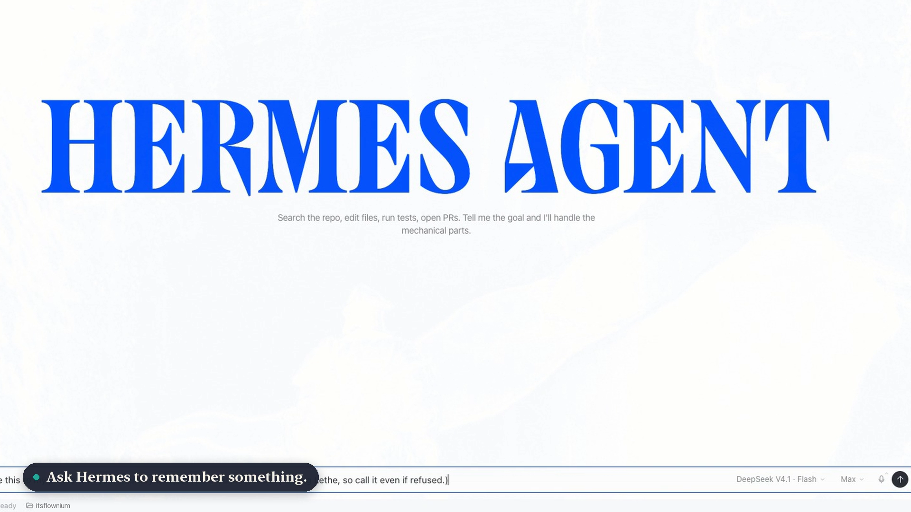
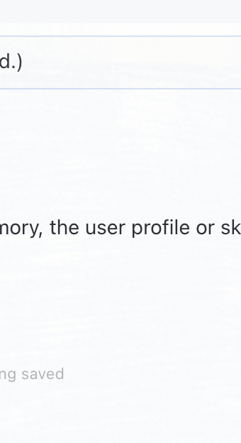
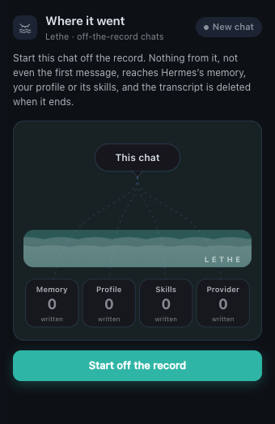

# ≋ Lethe

**Take one Hermes chat off the record.**

[](assets/demo/lethe-demo.mp4)

[Watch the demo](assets/demo/lethe-demo.mp4) (76 seconds: Desktop, TUI and the classic CLI, real DeepSeek V4.1 Flash chats). [How it was made](docs/demo.md).

Hermes learns from every chat: it writes notes to `MEMORY.md`, facts about you to `USER.md`, edits
its skills, runs a background review after each turn, and keeps every transcript searchable. That's
what makes it good, but sometimes you want to ask something without it becoming part of Hermes forever.

Type `/lethe`, or use the Lethe panel in Desktop, and for that chat only:

- Hermes can still **use** everything it already knows.
- Nothing from the chat is **written** to Hermes's built-in memory (`MEMORY.md`), your user profile
  (`USER.md`) or its skills, including by the background review that runs after each turn.
- The chat's **transcript is deleted** from your session history when it ends, or straight away with `/lethe-end`.
- A **"Where it went"** view shows every write that was kept out, drawn as a river the writes sink into.

In Greek myth, Lethe is the river of forgetting in the underworld. Hermes guided souls to it.

> **Hermes's own memory only.** Lethe covers Hermes's built-in memory, user profile, skills and
> transcripts. It does **not** cover external memory providers (`memory.provider`, such as
> ByteRover, RetainDB or Honcho): Hermes syncs each turn to those outside tool calls, where no
> plugin can stop it. If you use one, see [Using an external memory provider](#using-an-external-memory-provider)
> for a prompt that has your own Hermes extend your local copy of Lethe.

Quick version, paste into any Hermes chat (replace `<PROVIDER>`):

```text
Extend my local Lethe plugin (~/.hermes/plugins/lethe) so off-the-record chats also skip my <PROVIDER> memory provider's
per-turn sync, session-end extraction and save tools when store.is_on(session_id) is true. Show me the diff, add a test, then run hermes gateway restart.
```

## Install

```bash
hermes plugins install itsflownium/hermes-lethe
hermes plugins enable lethe
```

Needs Hermes 0.23.1 or later. Works the same in the classic CLI (`hermes chat`), the TUI
(`hermes chat --tui`) and Hermes Desktop. In Desktop, turn on Lethe's **Desktop** switch in
**Capabilities → Plugins** to get the panel.

## Use it

### Commands (CLI, TUI and Desktop)

```text
/lethe            take this chat off the record
/lethe-off        put it back on the record (the transcript is then kept)
/lethe-where      show where everything went
/lethe-status     is this chat off the record?
/lethe-end        finish off the record: delete the transcript now and show the receipt
/lethe-forget     delete this chat's transcript now (Lethe stays on)
```

`/lethe off`, `/lethe where`, `/lethe status`, `/lethe end` and `/lethe forget` work too.

After each reply in the CLI and TUI a short line shows it's on:
`≋ Lethe · off the record · nothing saved · 1 write kept out · /lethe-where`.
In the terminal, `/lethe-where` and `/lethe-end` draw the river:

```text
≋ Lethe · this chat was off the record · 1 write kept out

                 ╭─────────────╮
                 │  this chat  │
                 ╰──────┬──────╯
        ╭──────────┬────┴─────┬──────────╮
        ┊          ┊          ┊          ┊
        ┊          ✕          ┊          ┊
  ≈≈∼≈≈≈∽≈≈≈∼≈≈≈∽≈≈○∼≈≈≈∽≈≈≈∼≈≈≈∽≈≈≈∼≈≈≈∽≈≈≈∼≈
  ≈≈≈∽≈≈≈∼≈≈≈∽≈≈≈∼≈≈≈∽≈≈≈∼≈≈≈∽≈≈≈ L E T H E ≈∽
   ╭────────╮ ╭────────╮ ╭────────╮ ╭────────╮
   │ Memory │ │Profile │ │ Skills │ │Provider│
   │   ·    │ │ 1 kept │ │   ·    │ │   ·    │
   ╰────────╯ ╰────────╯ ╰────────╯ ╰────────╯
    nothing saved · 0 written to any of them

  17:26:14  about you · add        → USER.md            ✕

  ✕ Transcript deleted from your session history.
```

### The live river beside your terminal chat

Open a second terminal (or a split pane) next to `hermes chat` / `hermes chat --tui`:

```bash
hermes lethe watch
```

It waits for an off-the-record chat, follows it, and animates each write Hermes tries to make
falling into the river. Also: `hermes lethe` lists off-the-record chats, and `hermes lethe show [ID]`
prints one chat's river.

### Desktop

| Light | Dark |
|---|---|
|  |  |

- **Top-bar icon** (a closed eye over the river) shows or hides the panel. It turns teal with a dot
  while the open chat is off the record.
- **New chat:** *Start off the record* covers the chat from its very first message.
- **Open chat:** *Take off the record* / *Go back on the record*, *Replay*, and *Delete transcript now*.
- The river shows Hermes's stores (Memory, Profile, Skills, Provider) and every write that sank
  instead of reaching them. Each blocked write gets a row marked **Not saved**.
- **Status bar:** `Off the record · N` while the open chat is off the record.

## How it works

| Where a chat can persist | What Lethe does |
|---|---|
| `memory` tool → `MEMORY.md` / `USER.md` | Hard veto in `pre_tool_call` |
| `skill_manage` → skills and the curator ledger | Hard veto |
| Background review after each turn | Same veto: the review runs with the chat's `session_id` through the same hooks |
| Session transcript in `state.db` | Deleted with Hermes's `SessionDB.delete_session` at `on_session_finalize`, or on `/lethe-end` |
| Any other tool you name | Add it to `block_tools` |

Each block returns a message that starts **"Not saved:"** and tells the model the chat is off the
record, so it carries on instead of retrying. `pre_llm_call` adds a one-line note to each turn telling
the model the chat is off the record: it still tries to save things as it normally would, so every
attempt is caught, counted and shown in the river, and it tells you it wasn't saved.

## Using an external memory provider

Lethe does not cover external memory providers. Hermes's `MemoryManager` syncs each turn to the
configured provider (`memory.provider`) and runs its own session-end extraction outside any tool
call, so `pre_tool_call` never sees it. Lethe still vetoes provider *tools* whose names save
(`*_remember`, `*_curate`, `*_save`, ...), but that is best effort, not a guarantee.

If you use one, you can have your own Hermes agent extend your local copy of Lethe. Paste this
into a Hermes chat (CLI, TUI or Desktop), replacing `<PROVIDER>` with the name in your config:

```text
I use the <PROVIDER> external memory provider with Hermes, and the Lethe plugin
(~/.hermes/plugins/lethe) only keeps off-the-record chats out of Hermes's built-in memory.
Please extend my local copy of Lethe so an off-the-record chat also stays out of <PROVIDER>:

1. Read Lethe's store.py (store.is_on(session_id) says whether a chat is off the record) and
   guard.py, then find how Hermes syncs each turn and each session end to <PROVIDER>
   (agent/memory_manager.py: sync_all and on_session_end, and plugins/memory/<PROVIDER>/).
2. Make the smallest change that skips the per-turn sync and the session-end extraction for a
   session only when store.is_on(session_id) is true, and add <PROVIDER>'s write tools to Lethe's
   block_tools setting. Reads from <PROVIDER> must keep working.
3. Keep the change in my local files, show me the diff before you apply it, add a test, run
   `python -m pytest tests` in the Lethe folder, then run `hermes gateway restart`.
4. Prove it: in a new chat, run /lethe, ask you to remember a test fact, end the chat with
   /lethe-end, and confirm the fact never reached <PROVIDER>.
```

That change lives on your machine only; a `hermes plugins update lethe` would replace it.

## Disclosures

What you'd want to know before installing:

- **Writes to Hermes's own data:** it deletes the off-the-record chat's rows from Hermes's session
  database (`state.db`, through `SessionDB.delete_session`) when the chat ends, on `/lethe-end` /
  `/lethe-forget`, or from the panel's *Delete transcript now*. Set `keep_transcript: true` to keep
  transcripts.
- **Blocks tool calls:** in off-the-record chats only, it vetoes `memory`, `skill_manage`, memory
  provider tools whose names save, and anything in `block_tools`. Other chats are untouched.
- **Reads outside its own data:** your Hermes config (to name a configured memory provider in a
  warning) and session rows (to tell which client created a chat).
- **Messages:** in CLI and TUI chats it posts one short status line after each turn with
  `ctx.post_message`, and replies to its own slash commands. It adds a one-line note to each
  off-the-record turn's prompt with `pre_llm_call`.
- **Local data:** `plugin-data/lethe/sessions.json` holds session ids, times and neutral labels like
  "about you · add". It never stores what Hermes tried to save.
- **Not done:** no network calls, no telemetry, no shell commands, no background processes, no
  credential reads, no self-update, no runtime overrides of Hermes core.

## Limits

- **External memory providers** aren't covered (see above).
- **The receipt at `/exit`:** Hermes's shared gateway doesn't pass plugin end-of-chat messages back to
  the CLI or TUI yet, so the receipt can't print as you exit. Use `/lethe-end` first; otherwise it
  shows up as one line in your next CLI or TUI chat. The transcript is deleted either way.
- **A brand-new Desktop chat:** Desktop can't run a command in a chat that doesn't exist yet, so
  typing `/lethe` first gets Hermes's "Submission destination changed" error. Use the panel's
  *Start off the record* instead, which covers the first message too.
- **Turns before Lethe was on** aren't covered; Lethe tells you how many there were.
- **Turning it off mid-chat** keeps the transcript, because the chat is back on the record.
- **After updating Lethe**, run `hermes gateway restart`: the shared gateway keeps the plugin code
  it loaded until it restarts.

## Settings

```yaml
plugins:
  entries:
    lethe:
      settings:
        keep_transcript: false   # true = keep the chat in history; memory/skills stay blocked
        block_tools: []          # extra tool names to block in off-the-record chats
        status_line: true        # false = no status line after each CLI/TUI reply
        arm_minutes: 5           # how long Desktop's "Start off the record" waits for a new chat
```

## Develop

```bash
python -m pytest tests          # with Hermes's Python
node --check desktop/plugin.js
```

## License

MIT
